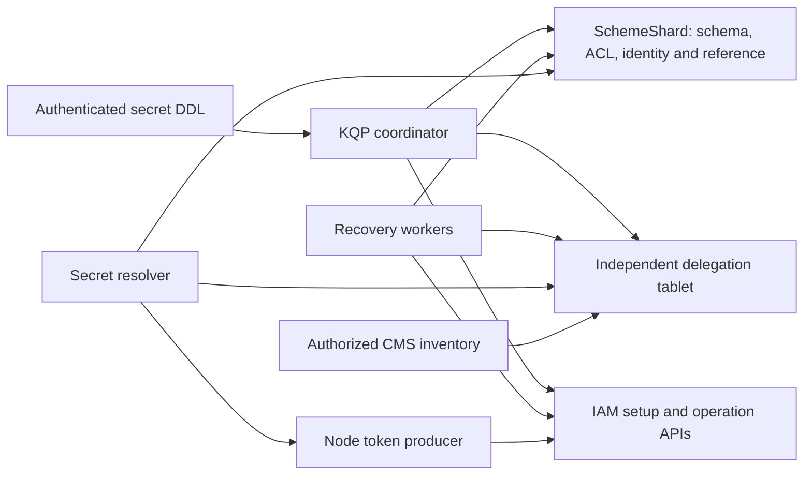

# Design

## Context

See [proposal.md](proposal.md) for the motivation and the component-local contracts linked from [README.md](README.md). This is a brownfield specification of the restored branch, followed by three review fixes. The restored baseline is `c68a9f3b2cafbdee3c6a3f870cb002166dda3dd7`; the selective-ALTER fix is `d1f1add797ecee712354057208f225dc68e92c11`. The token-wait fix is `8795e8bd1b186fc53051e5dd79126d9347a0e1b3`, verified by 44 secret-service and 57 IAM tests and an independent task review. S3 cancellation is implemented in `c098e4ceb695` with fixture correction `2e7842af118`, verified by 50 actor and 4 credential tests; its independent review and combined integration gates remain pending. The security-subtree consolidation and test-owned scenario specifications are complete in `87f8733958c`, verified by 166 IAM tests and independent task review.

The RFC's SQL surface remains the input contract. Its older SchemeShard-owned lifecycle description is superseded by the user's direction and the independent-tablet draft stack. The current component contracts are documented in [the tablet README](../../tablet/README.md) and [the coordination/recovery README](../../lifecycle/README.md).

## Goals / Non-Goals

**Goals:**

- Keep durable cleanup responsibility outside a tenant's lifetime, with immutable identities and transactionally consistent transitions.
- Keep authorization at the public/DDL boundary and repeat identity/ACL checks after asynchronous work.
- Make actor cancellation, storage retries and lost replies safe without claiming exactly-once remote IAM calls.
- Provide deterministic evidence at the actual commit, reply, timer and download-publication boundaries.

**Non-Goals:**

- New IAM replay guarantees, automatic resolution of an unknown first setup reply, or revocation of already issued tokens.
- Other secret providers, ydbcp implementation changes, or migration of replication/transfer consumers.
- Automatic per-database tablet provisioning, tablet-ID migration or terminal-record garbage collection.

## Decisions

### 1. An independent tablet owns the lifecycle

Use the normal Hive/local-tablet lifecycle under a service-owned owner whose storage survives managed tenants. `IamConfig.DelegationTabletId` locates the provisioned tablet; setting it does not create or migrate a tablet. Existing schema references retain their tablet IDs.

The tablet stores registered database incarnations, secret records, operation records, inventory indexes, revocation due-time indexes and replay receipts. It retains original binding fields and initiating subject/SID context, never authentication bearers or minted tokens. SchemeShard keeps ordinary schema responsibilities and immutable references/fences. IAM calls stay outside SchemeShard and storage transactions.

Keeping the queue in SchemeShard was rejected because its lifetime follows the tenant. A separate in-memory queue was rejected because replies, process restarts and tenant deletion must not lose cleanup ownership.

### 2. Persist intent before side effects; recover with identities and fences

CREATE allocates its schema transaction ID and saves a bounded schema intent before creating the ordinary secret shell. The authenticated schema operation checks the database incarnation and saved parent identity/version. Binding joins the operation to the completed full path ID. A successful durable `StartSetup` transition grants dispatch ownership once; setup results are saved before promotion.

ALTER performs authenticated schema authorization and identity/version fencing before staging a replacement. Promotion and predecessor enqueueing share one tablet transaction. DROP remains ordinary schema DDL; a bounded recovery scan detects retired identities. Parent/schema fences, rather than absence alone, decide whether an unbound CREATE can safely be retired.

Every transaction reads all required state before mutation and resets its prospective response on retry. Replies and remote effects occur only after the required durable transitions. Moving remote calls into a retryable transaction was rejected because page faults and transaction retries could replay them.

### 3. Unknown IAM outcomes remain accountable

Persisted IAM operation IDs are polled through the operation API. A lost first reply without a saved ID leaves setup uncertain and visible. `x-request-id` is tracing, not a proven idempotency contract. Ten minutes permits detaching an uncertain pending replacement; it does not prove that setup failed or authorize revocation while setup could still succeed.

A late success for a retired operation queues only that saved binding. A late failure cannot clear a newer pending slot. Blind setup replay and timeout-based cleanup were rejected because either could lose track of a late grant. An authoritative IAM replay/lookup contract would be a future change to this design, not an assumed dependency of this implementation.

### 4. Revocation is a leased durable outbox

Claims select due records through a bounded due-time index. A transaction leases an entire batch of at most 100 records for 1–60 seconds and updates affected inventory revisions atomically. Claim identity includes tablet generation, attempt, worker and deadline. A new acknowledgement is valid only strictly before the deadline; takeover is eligible at the deadline. An exact already-committed acknowledgement replay remains harmless until its claim/generation is superseded.

Workers use saved bindings and wait for authoritative IAM completion or absence. Retry outcomes retain durable work. Index scans are bounded and retry cleanly on cold pages. Unfenced acknowledgements and account-level deduplication were rejected because they could complete another worker's claim or another secret's binding.

### 5. Inventory is independent of live schema and uses optimistic pagination

Database registration preserves incarnations and aliases, including known empty databases. Discovery scans repeat to find registrations behind a prior cursor. Inventory continuations bind incarnation, revision and exclusive cursor; mutation returns `SNAPSHOT_EXPIRED`. Page sizes are 1–1000, and nonfinal pages are full to preserve short-page termination behavior.

The CMS handler authenticates administrators before using the trusted tablet protocol. Post-deletion/reused-path requests identify an incarnation explicitly. Listing is observational; the deletion control plane must stop admission and settle its cleanup boundary separately. Reconstructing inventory from live schema or pretending pagination holds an immutable snapshot was rejected.

### 6. DDL metadata lookup uses the operation's permission

The coordinator uses a synchronized authenticated SchemeCache lookup with explicit AlterSchema for ALTER/replacement metadata. Identity and description come from that same result. The final schema request still carries the serialized caller token and immutable fences. Public DescribeSchema and value SelectRow permissions remain separate.

SchemeCache can mask denial as a missing path, including for an authenticated zero-rights probe. A narrowly scoped internal existence probe therefore returns only a Boolean: any existing result rejects the operation; its metadata cannot provide a lifecycle identity or authorize a change. This preserves genuine missing-path/IF EXISTS behavior. The regressions include Describe-only, denied-both, unlisted and parent-only principals, ACL revocation and path recreation.

Continuing to use public Describe as a prerequisite was rejected because an authorized non-owner ALTER can legitimately lack DescribeSchema. Using privileged metadata to authorize a mutation was also rejected.

### 7. Token minting is shared, proactive and phase-bounded

The node cache key contains account, cloud and saved service/microservice/resource-type identity. One refresh loop serves concurrent demand. Successful tokens are usable only before `expiry - 5 minutes`; refresh is normally scheduled at half-life, capped by one hour and the usable deadline, with minimum pacing for near-boundary tokens. Idle entries expire after ten minutes when no waiter needs the next result. Transient failures preserve a still-usable token; authoritative permission-denied/not-found invalidates it.

The producer already bounds a next-attempt wait using maximum backoff plus credential/RPC retries. The current calculation is `75s + (2 * 10s + 14s) * 5 + 1s = 246s`. The reader shares this definition and adds one second of delivery allowance, for a 247-second token phase. Thirty-second storage/schema deadlines remain phase-specific, so stale phase timers cannot cut short a legitimate token wait. Caller retry policy and terminal status propagation remain unchanged.

Increasing one untagged whole-reader timeout was rejected because it would also prolong unrelated storage waits and would not identify stale timers. Reimplementing the producer's random backoff in a test was rejected; the regression drives actual IAM transport failures through the real producer and advances simulated time.

### 8. Consumers re-resolve and synchronize asynchronous cancellation

Credential providers retain the secret reference and verified caller identity. New S3, Solomon and SDK-backed requests acquire current credentials; concurrent acquisitions can share a resolution, but failure cannot return an older token. Readers check each entry's own path identity and recheck tablet revision, ACL and token usability after minting. Transport retries can retain the token of their already-authorized request.

S3 download hook publication and consumption must share synchronization. The pre-dispatch cancellation flag remains available while credentials resolve; a hook returned after cancellation is invoked immediately, exactly once, outside the lock. Shared ownership covers continuation lifetime but cannot substitute for synchronization.

The deterministic regression uses real asynchronous decoding and separate mailboxes: gateway callbacks can make the decoder cancel before the gateway returns its hook. An independently scheduled error recipient establishes that ordering without deadlocking the blocked parent mailbox. Reentrant/concurrent tests exercise the actual production cancellation mechanism. Sleep-based race-frequency tests and a copied model were rejected.

## Validation mapping

| Contract | Existing target / required evidence |
| --- | --- |
| Schema compatibility and SQL | `ydb/core/tx/schemeshard/ut_secret`, KQP provider and SQL translation suites from the restored baseline |
| Selective ALTER, revocation and path reuse | `ydb/core/kqp/executer_actor/ut`: valid pre-fix denial followed by 31 coordinator cases and 119 full-target cases passing at `d1f1add797e` |
| Atomic storage, leases, pagination and recovery | `ydb/core/security/iam_delegation/tablet/ut`: commit/reply boundaries, cold pages, fresh-runtime storage reopening and independent-model chaos schedules |
| Recovery orchestration | `ydb/core/security/iam_delegation/lifecycle/ut`, plus real-tablet/SchemeShard coordinator tests |
| Token validity, backoff and phase timers | `ydb/core/security/iam_delegation/ut` and `ydb/services/scheme_secret/ut/fast`; remaining timeout fix requires real-producer RED/GREEN evidence |
| Cancellation and credentials | S3 actor/credential suites; remaining race fix requires controlled cross-mailbox RED/GREEN evidence |
| Integration | Affected suites and the production driver library on the final source; review against all seven capability specs |

The restored baseline had 411 passing selected tests across 13 suites and 357 recovery executions (119 cases repeated three times). Those results describe `c68a9f3b2ca`, not an untested later tree. Per-fix commands, counts and exits are recorded in the implementation ledger; final verification must name its source revision. Archive test-result symlinks by dereferencing them, since live YA result links can later point to another run.

## Risks / Trade-offs

- **Unknown first setup reply** → Keep unresolved work visible and unrevokeable until an authoritative outcome is available; document the operational limit.
- **Tenant deletion or tablet reconfiguration** → Provision service-owned durable storage and retain recovery for old tablet IDs until inventory drains.
- **Concurrent inventory mutations** → Restart revision-bound pagination; do not claim snapshot retention or quiescence from listing.
- **ACL/cache publication races** → Use synchronized lookups and authenticated execution fences; tests assert effective ACL preconditions and exercise revocation during execution.
- **Cross-mailbox cancellation** → Synchronize both publication and consumption, invoke hooks outside the lock, and force the ordering in a real streaming test.
- **Large test binaries and unavailable remote cache** → Link large targets sequentially, keep sufficient temporary disk space, and preserve logs without clearing source/build caches.

## Migration Plan

1. Deploy binaries with tablet factory, IAM services, resolver and recovery registration; provision the service-owned tablet and configure its ID and token-manager/IAM endpoints.
2. Keep admission disabled until configuration and the relevant deterministic suites are verified. No schema-only toggle provisions storage.
3. Enable delegation-secret admission. Ordinary stored secrets keep their wire/value behavior; new delegation metadata is explicitly typed.
4. On rollback, disable new admission while retaining compatible readers, DROP and recovery for existing references. Do not remove the tablet or treat a configuration change as migration.
5. Coordinate database deletion with administrative inventory and the secret referrer type. Live IAM/control-plane deployment validation is an operational follow-up; the local test suite uses controlled external responses and does not establish undocumented IAM guarantees.
